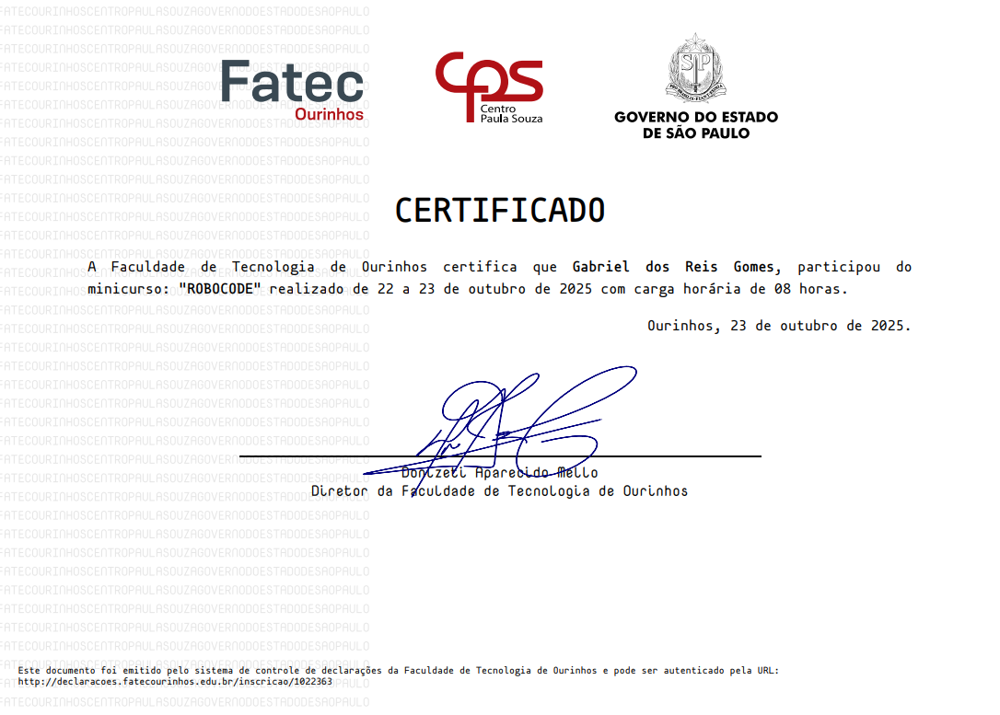

# 👨‍💻 Gabriel Gomes

**`<h2>Desenvolvedor FullStack</h2>`**

Me chamo Gabriel dos Reis Gomes, tenho 17 anos e sou natural de São Paulo. Atualmente, estou cursando o ensino médio com habilitação técnica em Análise e Desenvolvimento de Sistemas na ETEC Jacinto Ferreira de Sá. Gosto muito da área de tecnologia, busco aprender sempre mais sobre o ramo e compartilho meu conhecimento através do meu perfil no Linkedln "[Gabriel Gomes](https://www.linkedin.com/in/gabriel-dos-reis-gomes-b88411333/?isSelfProfile=true)", onde mostro minhas atividades, e publico meus projetos.

  
Certificados

        
  ## MINICURSOS

Semana de Tecnologia 2024

---

Game Maker

---

Explorando Vulnerabilidades em Aplicações WEB com o CAIDO

---

Linkedln - Uma Ferramenta Profissional

---

Técnicas de Desenvolvimento Seguro

---

Introdução ao React

---

XIX Semana da Tecnologia 2025

---

Criando seu Primeiro Personagem 2D com Inkscape

---

Introdução à Sonorização para Games

---

Robocode

---

Pentest Wireless - Quebra de Protocolo WEP Modo Open com Cliente Conectado

      
      
         
      
      
         

---

   ### 🤖 Back-end

   

   

   

   

   

   

 
 

---

### 🤖 Front-end

   

   

   

   

   

   

    
    

---

### 🤖 Banco de Dados

   

   

    
    

---

### 🤖 Ferramentas

   

   

   

   

   

   

   

   

   

   

   

   

   

    
    

---

### 🔎 Estatísticas

